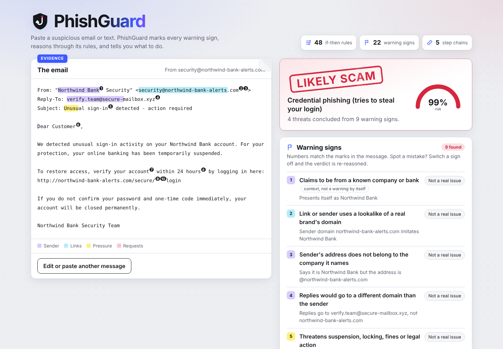
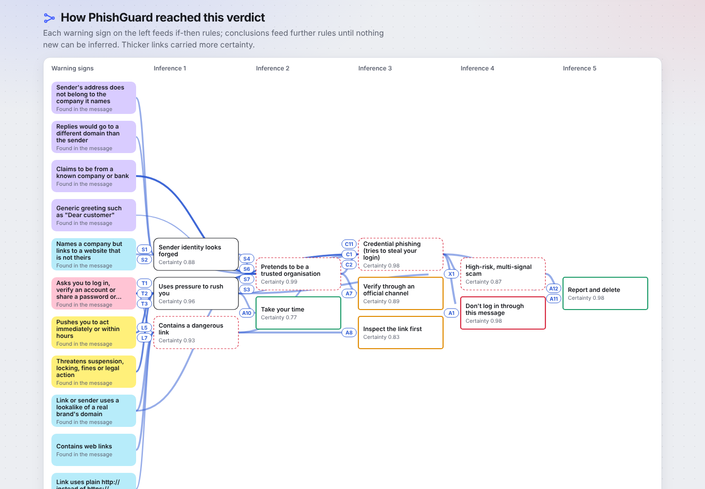

<div align="center">

# 🛡️ PhishGuard
### An explainable expert system that reads a suspicious message and shows exactly why it's a scam

**Paste a message → warning signs are marked → rules chain to a verdict → you see every step**


**Syntecxhub Internship · Artificial Intelligence · Week 1 · Project 2: Rule-Based Expert System**



</div>

---

## 🌟 Overview

Scam emails and texts work because people decide in seconds. **PhishGuard** slows that moment down and shows its work. You paste a message, and it does three things:

1. **Reads the message like an investigator.** It finds forged senders, lookalike domains (`streamfiix-account.com`), hidden link targets, shortened URLs, pressure language, and requests for passwords, codes, payments or card details. Each warning sign is **highlighted in the message itself**.
2. **Reasons with 48 if-then rules** using **forward chaining** and **certainty factors**. Warning signs become tactics, tactics become scam types, and scam types become advice. Chains run up to 5 rules deep.
3. **Explains every step:** a verdict stamp, a reasoning graph, a rule-by-rule log, and what would change the verdict.

You stay in charge. If a warning sign is wrong, switch it off; if the scanner missed one, add it. Either way the verdict is re-reasoned instantly.

Everything runs locally with the Python standard library. Messages are never uploaded, and links are never opened.

## ✅ Project requirements

| Requirement | Where it is implemented |
|---|---|
| Build a small rule engine (if-then rules) and a facts base | `expert_system/engine.py` (forward-chaining engine, working memory of facts and certainties); 48 rules in `knowledge/phishing.json` |
| Accept user facts (symptoms) and infer conclusions using forward chaining | Facts come from the message (`extractor.py`) and from the user, who can switch signs off or add missed ones; `infer()` runs match → resolve → fire to a fixed point |
| Support chaining of rules (multi-step inference) | e.g. `sender_mismatch → sender_spoofing → impersonation → credential_phishing → targeted_attack → report_message` (5 steps) |
| Log inference steps so the user can see the reasoning path | Reasoning log (each rule, premises, certainty arithmetic, explanation), reasoning graph, HOW proof trees, downloadable reports |

## 🚀 Quick start (Mac)

Python 3.9+, nothing to install.

```bash
cd phishguard
python3 phishguard_web.py
```

Your browser opens the inspector. Paste a message, or click a sample such as **Bank security alert**. Press `Ctrl+C` in Terminal to stop.

From the terminal:

```bash
python3 phishguard.py --sample bank_alert            # inspect a bundled sample
python3 phishguard.py inspect suspicious.eml         # inspect a saved email
pbpaste | python3 phishguard.py inspect              # inspect whatever is on your clipboard
```

## 🔎 Example

`python3 phishguard.py --sample bank_alert --brief` (excerpt):

```text
  VERDICT: LIKELY SCAM   (risk 99%)
  Most likely: Credential phishing (tries to steal your login)

WARNING SIGNS IN THIS EMAIL
  5. Link or sender uses a lookalike of a real brand's domain
     Sender domain northwind-bank-alerts.com imitates Northwind Bank
  7. Replies would go to a different domain than the sender
     Replies go to verify.team@secure-mailbox.xyz, not northwind-bank-alerts.com
  ...
WHAT TO DO
  [DANGER] Don't log in through this message: Do not click the link or enter any password or code...
```

`python3 phishguard.py explain ceo_fraud --sample ceo_giftcards` prints the proof tree:

```text
ceo_fraud  [CF 0.85]  Boss / CEO impersonation scam
├─ secrecy_request: detected   → C9
└─ asks_payment: detected   → C9
```

## 🧪 Bundled samples

All brands in the samples are fictional (Northwind Bank, ParcelPost, StreamFlix, CloudVault).

| Sample | What it is | PhishGuard's verdict |
|---|---|---|
| `bank_alert` | Fake security alert with lookalike sender and login link | Likely scam: credential phishing |
| `parcel_fee` | SMS asking for a customs fee via bit.ly | Likely scam: payment scam |
| `prize` | "You won an iPhone, pay shipping" | Likely scam: advance-fee / prize scam |
| `invoice_attachment` | Overdue invoice with a `.zip` attachment | Likely scam: possible malware delivery |
| `ceo_giftcards` | "CEO" on Gmail asking for secret gift cards | Likely scam: boss / CEO impersonation |
| `streaming_html` | HTML email whose link text hides a raw IP address | Likely scam: personal-data harvesting |
| `otp_whatsapp` | "Send me back the code I sent you" | Likely scam: account-takeover attempt |
| `genuine_receipt` | A real-looking receipt from the official domain | Low risk |

The tests also check that ordinary messages raise no alarm. These include a meeting invite, a real shipping notice, a genuine password-reset email, a friend's text, and a bank one-time-code SMS.

## 🧭 How it works

```text
message ──► extractor ──► facts (warning signs + certainty + highlighted text)
                               │
                               ▼
              forward-chaining engine + 48 rules (knowledge/phishing.json)
                               │
      signs ─► tactics ─► scam type ─► escalation ─► advice
                               │
                               ▼
            verdict, highlighted message, reasoning graph, log, what-if
```

**1. Fact extraction** (`expert_system/extractor.py`) reads email headers (From, Reply-To, Subject) and plain-text, HTML and SMS bodies. It compares sender and link domains with the real domains of known brands, and catches lookalikes such as digit swaps (`paypa1`), one-letter changes (`streamfiix`), hyphenated imitations (`northwind-bank-alerts`) and punycode. It also flags link shorteners, raw IP links, link text that hides another target, risky domain endings, `http://` login links, pressure and threat phrases, prize bait, secrecy requests, requests for passwords, codes, payments or card details, and risky attachments. A brand mentioned in passing ("bring my Apple charger") is not treated as a claim to *be* that brand.

**2. Rules** turn signs into conclusions:

```json
{"id": "C1", "if": ["asks_credentials", "impersonation"], "then": "credential_phishing",
 "cf": 0.85, "because": "An impersonator asking you to log in is trying to capture your credentials."}
```

| Layer | Rules | Example |
|---|---|---|
| Sender | S1–S7 | sender mismatch + brand claim → impersonation |
| Links | L1–L7 | link text ≠ target → hidden destination → dangerous link |
| Tactics | T1–T5 | urgency + threats → pressure tactics |
| Scam type | C1–C11 | code request → account takeover; secrecy + payment → CEO fraud |
| Escalation | X1–X4 | credential phishing + pressure → high-risk scam |
| Advice | A1–A14 | credential phishing → "Don't log in through this message" |

**3. The engine** (`expert_system/engine.py`) runs the classic recognise-act cycle:

1. **Match:** collect every unfired rule whose conditions hold.
2. **Resolve:** choose by stratum (dependency depth), then priority, then specificity.
3. **Fire:** `certainty = rule CF × min(premise certainties)`. Independent evidence for the same conclusion combines as `a + b(1 − a)` (MYCIN certainty factors), so three separate signs of impersonation make it more certain than any one alone.
4. **Repeat** until nothing new can be inferred. Each rule fires once, so it always terminates.

**4. Verdict.** The risk is the highest certainty among the threat conclusions: **Likely scam** from 70%, **Suspicious** from 40%, otherwise **Low risk**. The headline names the most specific scam type found.

## 🖥️ The inspector

- **Annotated message:** each warning sign highlighted and numbered by type: violet for sender, cyan for links, yellow for pressure, pink for requests.
- **Verdict stamp and risk meter.**
- **Warning signs** with the exact reason for each, plus **Not a real issue** and **Add a sign the scanner missed** controls that re-run the reasoning.
- **What to do:** advice ranked danger, then caution, then good practice.
- **Reasoning graph** from warning signs to advice, **reasoning log**, **what would change the verdict**, and report export (Markdown, JSON, text).

Works in light and dark mode and on phones.



## 🛠️ Command reference

```bash
python3 phishguard.py samples                                  # list samples
python3 phishguard.py inspect FILE | --sample NAME | --text "…"
python3 phishguard.py inspect FILE --json                      # full machine-readable analysis
python3 phishguard.py inspect FILE --report output/report.md   # save .md / .json / .txt
python3 phishguard.py explain credential_phishing --sample bank_alert
python3 phishguard.py rules                                    # print the rule base
python3 phishguard.py lint                                     # validate the rule base
python3 phishguard_web.py --port 9000 --no-browser
```

## 📁 Project structure

```text
phishguard/
├── expert_system/
│   ├── extractor.py      # message → warning-sign facts with highlighted evidence
│   ├── engine.py         # forward chaining, certainty factors, conflict resolution, WHY/HOW, what-if, graph
│   ├── knowledge.py      # rule-base model, JSON loading, validation (lint)
│   ├── inspect.py        # extract → reason → verdict pipeline
│   ├── report.py         # text / Markdown / JSON reports, proof trees
│   ├── webapp.py         # local web server (127.0.0.1 only)
│   └── cli.py            # inspect, explain, samples, rules, lint
├── knowledge/phishing.json   # 22 warning signs, 48 rules, 10 actions, verdict bands
├── samples/              # 8 sample messages (fictional brands) + index
├── web/index.html        # inspector UI (HTML/CSS/JS, no frameworks)
├── phishguard.py         # CLI entry point
├── phishguard_web.py     # web entry point
├── docs/                 # screenshots and sample reports
└── tests/                # 25 unit tests
```

## 🧪 Testing

```bash
python3 -m unittest discover -s tests -t . -v
```

The 25 tests cover:

- **Lookalike detection:** digit swaps, one-letter changes, hyphenated imitations, punycode, with official domains never flagged.
- **Extraction:** signals per sample, HTML link-text mismatch and IP links, attachment names and email addresses not mistaken for links, brands mentioned in passing not counted as claims, highlight offsets pointing at the right text.
- **Reasoning:** every sample's verdict and scam type, no false alarms on five ordinary messages, a 5-step chain, overrides re-reasoning the verdict, danger-first advice, identical results after shuffling the rule file, a clean rule base.
- **CLI and web API:** commands, reports, error codes, rejection of malformed requests.

Tested on Python 3.9 and 3.13. GitHub Actions runs the suite on 3.9–3.13.

## ⚠️ Limitations

- A verdict is an assessment of warning signs, not proof. A well-crafted scam with none of these signs will score low, so stay sceptical, and verify through a channel you already trust.
- PhishGuard does not check sender authentication (SPF/DKIM), open links or look up domain age. That keeps it fully offline and safe, but those checks would add evidence.
- The brand list and phrase patterns are a starting set. Add brands to `BRANDS` in `extractor.py`, and rules to `knowledge/phishing.json`, then run `lint`.
- Certainty factors are hand-set heuristics, not calibrated probabilities.

## 📚 References

- Shortliffe, E. H., & Buchanan, B. G. (1975). *A model of inexact reasoning in medicine.* Mathematical Biosciences, 23, 351–379. (Certainty factors.)
- Russell, S., & Norvig, P. *Artificial Intelligence: A Modern Approach*, chapter on logical agents and forward chaining.
